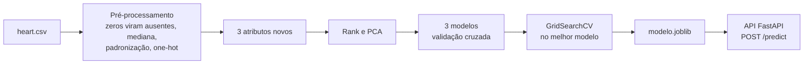

# Pipeline Heart Failure

**Pipeline automatizado de ciência de dados que prevê doença cardíaca a partir de 11 dados clínicos e entrega o melhor modelo em uma API pública.**


> [!NOTE]
> Projeto final da disciplina Aplicação de Ciência de Dados, no curso de Sistemas Inteligentes da Fatec "Shunji Nishimura", Pompeia. O modelo é um exercício acadêmico e **não tem validade clínica**.

## O problema e a solução

Doenças cardiovasculares são a principal causa de morte no mundo, e a detecção precoce reduz o risco. O projeto usa o conjunto público *Heart Failure Prediction* (918 pacientes, 11 atributos clínicos e o alvo `HeartDisease`) para treinar um classificador binário e disponibilizá-lo por uma API.



Todas as etapas ficam em um único `Pipeline` do scikit-learn, ajustado só com os dados de treino. A API recebe os 11 atributos originais do paciente e aplica exatamente as mesmas transformações do treino.

## O que entrega

- **Notebook** reprodutível, com índice, dicionário de dados e leitura de cada resultado ([`notebooks/pipeline.ipynb`](notebooks/pipeline.ipynb)).
- **Três atributos novos:** `FaixaEtaria`, `MaxHR_pct` (frequência máxima sobre a teórica, 220 menos a idade) e `ColesterolAlto`.
- **Redução de dimensionalidade** por Rank (informação mútua) e PCA, com o Rank no modelo final.
- **Três modelos comparados:** Regressão Logística, Random Forest e KNN, com validação cruzada estratificada de 5 partições.
- **Otimização de hiperparâmetros** com `GridSearchCV`, comparada ao modelo padrão.
- **API REST** sem autenticação, empacotada em Docker.
- **Relatório** em PDF e Word, nas normas da ABNT.

## Resultados e limites do modelo

Medidos em 184 pacientes de teste (20% do conjunto, nunca vistos no treino), com hiperparâmetros padrão:

| Modelo | Acurácia | Precisão | Recall | F1 | AUC |
| --- | --- | --- | --- | --- | --- |
| Regressão Logística | **89,67%** | **90,29%** | **91,18%** | **90,73%** | **93,65%** |
| Random Forest | 85,33% | 86,41% | 87,25% | 86,83% | 91,98% |
| KNN | 83,70% | 83,96% | 87,25% | 85,58% | 90,14% |

A Regressão Logística foi otimizada com `GridSearchCV` (`C` = 0,1, `class_weight` sem balanceamento, todos os atributos):

| Regressão Logística | Acurácia | Precisão | Recall | F1 | AUC |
| --- | --- | --- | --- | --- | --- |
| Padrão | 89,67% | 90,29% | 91,18% | 90,73% | 93,65% |
| Otimizada | 89,67% | 89,52% | **92,16%** | **90,82%** | 93,38% |

**Limites:** o ganho da otimização equivale a um paciente a mais detectado (94 de 102, contra 93), o que está dentro da variação esperada com um teste tão pequeno. O conjunto tem só 918 pacientes, a avaliação usa uma única divisão treino e teste e não houve validação externa com dados de outra população.

## Tecnologias

- Python 3.12, pandas e NumPy
- scikit-learn 1.9 (Pipeline, `SelectKBest`, PCA e `GridSearchCV`)
- matplotlib e seaborn
- FastAPI, Pydantic e Uvicorn
- Docker
- Jupyter, pytest e joblib

## Executar localmente

Pré-requisitos: Python 3.12 e, para a API em contêiner, o [Docker Desktop](https://www.docker.com/products/docker-desktop/).

```bash
# 1. ambiente virtual e dependências
python -m venv .venv
source .venv/bin/activate        # Windows: .venv\Scripts\activate
pip install -r requirements.txt

# 2. treina os modelos e grava models/modelo.joblib e as figuras do relatório
cd notebooks
jupyter nbconvert --to notebook --execute --inplace pipeline.ipynb
cd ..

# 3. sobe a API
docker build -t heart-api .
docker run -p 8000:8000 heart-api
```

A documentação interativa (Swagger) fica em <http://localhost:8000/docs>.

## API

| Rota | O que faz |
| --- | --- |
| `GET /` | Informações gerais e modelo em uso |
| `GET /health` | Verificação de saúde do serviço |
| `POST /predict` | Recebe os 11 atributos do paciente e devolve a classe e a probabilidade |
| `GET /docs` | Documentação interativa (Swagger) |

```bash
curl -X POST http://localhost:8000/predict -H "Content-Type: application/json" \
  -d '{"Age":58,"Sex":"M","ChestPainType":"ASY","RestingBP":140,"Cholesterol":0,"FastingBS":1,"RestingECG":"Normal","MaxHR":110,"ExerciseAngina":"Y","Oldpeak":1.5,"ST_Slope":"Flat"}'
```

Resposta: `{"doenca_cardiaca":1,"probabilidade_doenca":0.9769,"diagnostico":"Alto risco de doença cardíaca"}`.

Entradas inválidas (por exemplo `Sex` diferente de `M` ou `F`) recebem erro `422`.

## Publicação

A API ainda não está publicada. Para colocá-la no ar no Render:

1. Crie um **Web Service** conectado a este repositório.
2. Escolha o ambiente **Docker**; o `Dockerfile` da raiz é detectado automaticamente.
3. Use o plano gratuito, sem variáveis de ambiente (a porta vem de `PORT`).

## Testes

```bash
pytest          # testes da API com o modelo real
```

Os testes precisam do `pydantic` instalado normalmente. Onde isso não for possível, rode a API em contêiner e use o `curl` acima.

## Estrutura do repositório

| Pasta | Conteúdo |
| --- | --- |
| `data/` | Conjunto `heart.csv` |
| `notebooks/` | `pipeline.ipynb`: pré-processamento, atributos novos, Rank e PCA, modelos, otimização e exportação |
| `src/` | `features.py`: limpeza e atributos novos, compartilhados entre o treino e a API |
| `models/` | `modelo.joblib` e as tabelas de métricas e hiperparâmetros |
| `api/` | API FastAPI e seus contratos de entrada e saída |
| `tests/` | Testes da API |
| `relatorio/` | Figuras, relatório em PDF e Word, e os scripts que os geram |

## Relatório

O relatório em ABNT (capa, folha de rosto, resumo, abstract, sumário, texto e referências) está em [`relatorio/relatorio_final.pdf`](relatorio/relatorio_final.pdf), com uma versão editável em [`relatorio/relatorio_final.docx`](relatorio/relatorio_final.docx). Para gerá-los de novo depois de alterar o texto ou os dados da capa:

```bash
python relatorio/gerar_relatorio.py <pasta_temporaria> relatorio/relatorio_final.pdf
python relatorio/gerar_docx.py <pasta_temporaria> relatorio/relatorio_final.docx
```

O PDF usa o Microsoft Edge instalado. Use a mesma pasta temporária nos dois comandos.

## Integrantes

- Pedro Lucas Francisco
- Nathalia Rodrigues
- Pedro Henrique Cavalcante

Orientação: professor João Ricardo Favan.

## Commits

Em português, no formato `tipo: descrição` (`feat`, `fix`, `docs`, `refactor`, `chore`), sem marcas de ferramenta.
